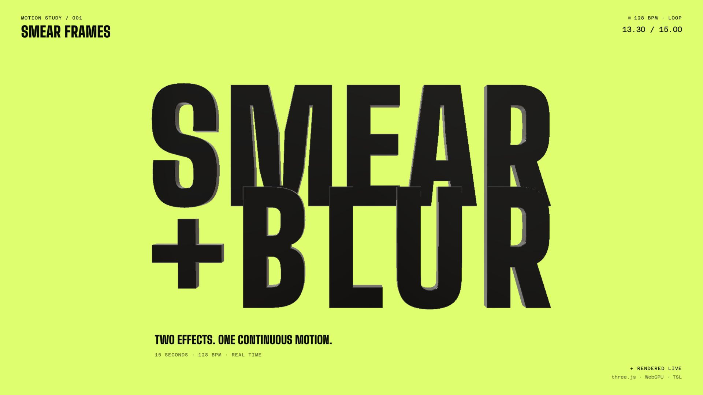

# Smear Frames × Motion Blur Showreel



A 15-second, beat-synced motion piece that shows off two real-time effects working together in three.js: smear frames, which stretch the geometry itself along the path it just travelled, and screen-space motion blur, which reconstructs what a camera shutter would have seen between two frames. Everything runs live on `WebGPURenderer` with TSL: there is no pre-rendered video, and the loop is seamless and fully deterministic.

The two effects are designed to read as one. The smear keeps the leading silhouette sharp and drags a tapered tail behind each object, and the deformed previous pose is fed to the velocity pass, so the blur follows the smeared silhouette rather than the undeformed mesh. An A/B beat halfway through splits the trio into mirrored twins: the same motion, raw on the left and with smear + blur on the right.

**Live: [smear.niccolofanton.dev](https://smear.niccolofanton.dev)**

The home page plays the motion graphics reel. Add [`?debug=true`](https://smear.niccolofanton.dev/?debug=true) to open the original three-mesh scene with its interactive Tweakpane controls. The debug scene includes independent shape, material, movement, smear and blur settings.

```bash
pnpm install
pnpm dev       # vite
pnpm build     # -> dist
pnpm test      # loop continuity and music pulse checks
```

## How it works

**Smear frames** (`src/velocitySmear.js`, `src/trail.js`). Each object samples its own past positions at 1/3, 2/3 and 1 of a short exposure window and fits a cubic Bézier through them. The vertex shader pulls the trailing half of the mesh along that curve, and a taper narrows the tail toward its tip. The same deformation is applied to the previous frame's pose and written to `positionPrevious`, so the MRT velocity output measures the visible, smeared shape.

**Motion blur** (`src/directionalMotionBlur.js`). A TSL implementation of McGuire et al., *A Reconstruction Filter for Plausible Motion Blur* (2012). One MRT pass writes colour, velocity and depth. A separable TileMax (rows, then columns) and a 3×3 NeighborMax give every pixel the dominant motion around it, so static background pixels can gather colour from an object moving past them and streaks extend beyond the silhouette. A depth-aware gather then weights each sample by its own velocity, with 9, 17 or 25 taps chosen by streak length. Lit materials are tone mapped before the blur, so it averages display colours and edges never tint. Velocities are normalised to a 1/120 s exposure, so the look does not change with the display's refresh rate.

**Timeline** (`src/reel.js`, `src/timeline.js`). The reel is cut at 128 BPM: letters land on the beat, a whip pan hides inside a break, and the title explodes out of a vortex of thirty objects on the downbeat. A 15-second excerpt of Matroda's *About To Lose It* ships in `public/audio/smear-loop.mp3`; the full source track stays local. After the visitor presses Play, Web Audio drives the reel clock and loops the excerpt with the animation.

**Music pulse** (`src/rhythm.js`). A shared 128 BPM envelope drives the scale of the 3D objects and letters, plus a subtle brightness pulse in the background. The HUD stays still; only its square beat indicator pulses, and a readout reports the live blur streak and smear stretch. Bass energy is measured once from the decoded soundtrack to accent each beat; playback follows the audio clock so the elements stay together through pauses and loops. `?mute` silences the output while keeping the soundtrack analysis and audio clock active.

**Options.** `?perf` shows frame time and dropped frames, `?res=4112x2294` forces a render resolution for measuring, and `?t=7.5` picks the cover frame. After pressing play, Space pauses, ←/→ step by 1/120 s, and `#t=7.5` jumps to a time.

Use `?mute` for silent development playback and `?still&t=13.1&mute` for a clean title still. The cover is warmed before it is revealed, including its previous-frame transforms.

**Typography.** Big Shoulders Black (900, optical size 72) shapes SMEAR, BLUR, the closing wordmark and the display labels; BLUR shares SMEAR's spacing and is neon green on ink black: flat faces in the exact acid green `#70FF00`, with darker returns shaded from a fixed light so the letters stay 3D. Glyph outlines drop the collinear samples the font draws as flat curves, which would otherwise flip the extrusion normals. Azeret Mono Regular handles captions and tabular timecodes. The two closing title rows share optical edges and the original four depth planes. Local WOFF2 files, the 3D typeface subset and the font licences live in `public/fonts/`. See [the design notes](docs/type-design.md) for the grid and rebuild instructions.

**Colour and choreography.** Nothing stops and nothing snaps: accents come from speed peaking on the hits, so the smear and blur swell with the kick instead of flashing between holds. The slam on the drop is the one deliberate impact, sold with squash. The opening trio uses hot pink, electric violet and acid green; after the slam, the knot and gem ride a tilted carousel around the sphere, passing back through the row on beats 2 and 4 and sweeping low in front of it on beats 1 and 3. Violet carries into the final swarm. During SMEAR the sphere travels along a constant-pitch helix around the word's horizontal axis, passing in front and behind the letters with a smaller scale and a wider camera frame.

## Credits

The smear and blur come from `three-starter-smear-frames`, a fork of [three-starter-motion-blur](https://github.com/niccolofanton/three-starter-motion-blur), whose directional blur was inspired by Cullen Webber's [Self-Shadowing Particles + Tracery Effect](https://cullenwebber.github.io/three-particles/). The reconstruction filter follows McGuire, Hennessy, Bukowski and Osman (I3D 2012).

Fonts: [Big Shoulders](https://github.com/google/fonts/tree/main/ofl/bigshoulders), copyright 2019 The Big Shoulders Project Authors; [Azeret Mono](https://github.com/google/fonts/tree/main/ofl/azeretmono), copyright 2021 The Azeret Project Authors. Both are distributed under the SIL Open Font License 1.1. Source TTFs are retained in `assets/fonts/`; their licences are the corresponding `OFL-*.txt` files in `public/fonts/`.
